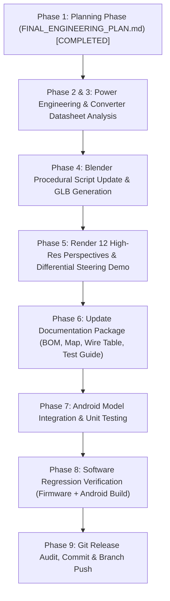

# ROBO RACER 4WD — FINAL ENGINEERING DIGITAL TWIN, PHYSICAL BUILD READINESS & PRODUCTION-QUALITY 3D MODEL
## MASTER ENGINEERING PLAN

**Document Path:** `docs/finalization/FINAL_ENGINEERING_PLAN.md`  
**Date:** 2026-10-19  
**Repository:** `https://github.com/Tara1903/rc-car`  
**Working Branch:** `fix/robo-racer-integration-safety`  
**Baseline Commit:** `b4fcb14` — *`fix(hardware): reconcile DC-DC identification, alkaline power budget, and motor test isolation`*  
**Status:** APPROVED FOR AUTONOMOUS EXECUTION

---

## 1. Executive Summary & Baseline Status

The Robo Racer 4WD project couples an ESP32 embedded robot with hard-real-time motor safety controls, a native Android Jetpack Compose controller UI, and an interactive 3D digital twin rendered via custom OpenGL ES shaders.

This master engineering plan transitions the project from preliminary design to **complete physical build readiness and production-quality 3D digital twin fidelity**.

### 1.1 Repository Baseline Status
- **Git State:** Verified clean working tree on branch `fix/robo-racer-integration-safety` at commit `b4fcb14`.
- **Verified Local Toolchains:**
  - Blender: `5.2.0 LTS` at `C:\Program Files\Blender Foundation\Blender 5.2\blender.exe`
  - Python: `3.11.9 (ucrt64)` at `C:\msys64\ucrt64\bin\python.exe`
  - C++ Compiler: `g++ 14.1.0 (ucrt64)` at `C:\msys64\ucrt64\bin\g++.exe`
  - Android Build System: Gradle Wrapper (`gradlew.bat`) with Android SDK 35 & JDK 17
  - Android Debug Bridge: `adb.exe` at `C:\Users\taras\AppData\Local\Android\Sdk\platform-tools\adb.exe`
  - Virtual Device: `Pixel_10_Pro` AVD configured in local SDK

---

## 2. Authoritative Hardware Inventory & Evidence Classification

Every attribute and subsystem is classified strictly under the 7-tier verification framework:
- **`VERIFIED`**: Confirmed by primary product listing photos, manufacturer datasheets, or explicit hardware inspection.
- **`DOCUMENTED`**: Formally specified in repository files (`config.h`, schematics, wire tables), but awaiting physical confirmation.
- **`ESTIMATED`**: Deduced from photographic scaling, standard metric conventions, or circuit topology analysis.
- **`PROVISIONAL`**: Retained for system documentation and wiring layout, but subject to physical validation before deployment.
- **`BLOCKED`**: Safety-critical uncertainty or specification mismatch requiring physical inspection/measurement before power-up.
- **`PHYSICALLY TESTED`**: Tested on real hardware with physical bench instruments (multimeter, power supply).
- **`NOT TESTED`**: Software or hardware check not yet executed on physical bench.

### Master Hardware Classification Table

| Ref ID | Subsystem | Component Description | Manufacturer / Listing Reference | Classification | Evidence & Engineering Rationale |
|---|---|---|---|:---:|---|
| **CTL-01** | Controller | ESP32 DevKit V1 (30-Pin) | NodeMCU-32S / ESP-WROOM-32 | **VERIFIED** / **DOCUMENTED** | Verified from user photo `media_1792340893404_e9ffa99b.png`. 30-pin dual-row header, CP2102 USB bridge, PCB antenna. Firmware mapping in `config.h`. (Physical bench: **NOT TESTED**). |
| **DRV-01** | Drivetrain | L298N Dual H-Bridge Driver (Left) | STMicroelectronics L298N Module | **VERIFIED** / **DOCUMENTED** | Verified from photo `media_1792340893405_6df9107a.png`. Red PCB, Multiwatt15 package, aluminum heatsink, 78M05 regulator. Drives FL & RL motors. (Physical bench: **NOT TESTED**). |
| **DRV-02** | Drivetrain | L298N Dual H-Bridge Driver (Right) | STMicroelectronics L298N Module | **VERIFIED** / **DOCUMENTED** | Identical module. Drives FR & RR motors. Jumpers `5V-EN`, `ENA`, `ENB` removed. (Physical bench: **NOT TESTED**). |
| **ACT-01** | Drivetrain | 4× Yellow TT Geared DC Motors | Zhengke / Standard TT 1:48 | **VERIFIED** / **DOCUMENTED** | Verified from kit photo `media_1792340893363_d467156d.png`. Yellow plastic gearbox canister, dual flat shafts, 3–6V DC. (Physical bench: **NOT TESTED**). |
| **ACT-02** | Drivetrain | 4× Rubber Tires & Yellow Hubs | 66 mm OD × 26 mm width | **VERIFIED** / **DOCUMENTED** | Verified in kit photo. Chevron tread profile, yellow 5-spoke ABS rims. (Physical bench: **NOT TESTED**). |
| **PWR-01** | Power | Adjustable DC-DC Converter | amiciSolar XL6019 / Generic Blue Module | **BLOCKED — REGULATOR NOT SUITABLE OR NOT VERIFIED** | Verified from user photo `media_1792340893405_c057a99d.png` and Flipkart listing. 2× shielded "330" inductors, 3296W trimpot, 2× electrolytic caps. **Critical Block:** XL6019 datasheet mandates $V_{IN} \ge 5.0\text{V}$; under 4-motor inrush, 4× AA alkaline pack sags to $3.8\text{V}-4.5\text{V}$, potentially causing regulator dropout/UVLO and ESP32 brownout. Output connections remain **PROVISIONAL**. |
| **PWR-02** | Power | 4-Cell AA Battery Holder Tray | Standard 4-slot cylindrical tray | **VERIFIED** / **DOCUMENTED** | Verified in kit photo. 4 slots with leaf springs and red/black leads. Intended cells: 4× AA Alkaline (Duracell / Eveready). Nominal 6.0V, 6.4V fresh open-circuit, 4.4V cutoff. (Physical bench: **NOT TESTED**). |
| **MCH-01** | Chassis | 4WD Double-Deck Acrylic Plates | Laser-cut acrylic with kraft paper | **VERIFIED** / **ESTIMATED** | Verified in kit photo. Contoured front/rear bumpers, side wheel wells, cross-shaped cutouts. Dimensions estimated at ~220 × 110 × 3 mm based on standard kit scale. |
| **MCH-02** | Chassis | 6× Brass Standoffs & Fasteners | M3 × 30 mm brass pillars + M3 screws | **VERIFIED** | Visible in kit photo. Establishes 30 mm deck clearance. |
| **MCH-03** | Chassis | 4× Optical Encoder Discs | 20-slot slotted discs | **VERIFIED** | Visible in kit photo. Mounted to inner motor shafts. |
| **SW-00** | Power | Master Power Switch | **NONE AVAILABLE / NONE INSTALLED** | **VERIFIED** | User explicitly confirmed no switch is available. Direct unswitched battery wiring; manual disconnect mandatory. |
| **FUS-00** | Power | Inline 3A Fuse | Mini blade fuse | **DOCUMENTED ONLY (NOT INSTALLED)** | Documented as recommended safety upgrade; NOT modeled as installed hardware. |

---

## 3. Power Architecture & Safety Engineering Gate

### 3.1 4× AA Alkaline Battery Characteristics
- **Chemistry:** 4× AA Alkaline (Duracell / Eveready).
- **Open-Circuit Voltage:**
  - Fresh pack max: $4 \times 1.60\,\text{V} = 6.40\,\text{V}$.
  - Nominal pack: $4 \times 1.50\,\text{V} = 6.00\,\text{V}$.
  - Discharged cutoff: $4 \times 1.10\,\text{V} = 4.40\,\text{V}$.
- **Internal Resistance & Dynamic Sag:**
  - Alkaline cells exhibit internal resistance $R_i \approx 0.15\,\Omega - 0.30\,\Omega$ per cell ($R_{i,pack} \approx 0.6\,\Omega - 1.2\,\Omega$ fresh, rising above $2.0\,\Omega$ depleted).
  - Under 4-motor inrush or skid-steer pivot current ($2.4\,\text{A} - 3.5\,\text{A}$), terminal voltage experiences severe dynamic sag:
    $$\Delta V_{sag} = I_{total} \times R_{i,pack} \approx 2.5\,\text{A} \times 0.8\,\Omega = 2.0\,\text{V}$$
  - A nominal $6.0\,\text{V}$ pack instantaneously sags down to **$4.0\,\text{V} - 4.5\,\text{V}$**.

### 3.2 XL6019 Regulator Technical Investigation & Safety Gate
- **Manufacturer Datasheet Reference:** `https://www.xlsemi.com/datasheet/XL6019-EN.pdf`
- **Key Specifications from Datasheet:**
  - Operating Input Voltage ($V_{IN}$): **$5.0\,\text{V}$ to $40\,\text{V}$**.
  - Internal UVLO: Typically trips around $4.0\,\text{V} - 4.5\,\text{V}$.
  - Switching Frequency: Fixed $180\,\text{kHz}$.
  - Maximum Switch Current: $5.0\,\text{A}$.
  - Feedback Voltage: $1.25\,\text{V} \pm 1.5\%$.
  - Package: TO-263-5L.
- **Critical Engineering Evaluation:**
  1. **Minimum Operating Input Issue:** The manufacturer datasheet explicitly specifies **$5.0\,\text{V}$ minimum input voltage**. When the 4× AA alkaline battery pack sags below $5.0\,\text{V}$ (reaching $3.8\,\text{V}-4.5\,\text{V}$ under motor inrush), the XL6019 enters an unsupported low-voltage regime or under-voltage lockout.
  2. **Topological Ambiguity:** The board possesses two inductors, but without tracing PCB copper or reading the chip under magnification, it cannot be proven whether the board is a true SEPIC converter, a non-inverting buck-boost, or a boost converter with an output $LC$ ripple filter.
  3. **Overvoltage Risk:** If the module is a boost-only converter with an LC filter, it cannot step down voltage ($V_{OUT} \ge V_{IN}$). Feeding it 6.4V from fresh cells would pass ~6.4V into the ESP32 `VIN` pin, over-stressing the onboard 3.3V LDO.
- **Formal Design Decision:**
  - The power subsystem is formally classified as:
    **`BLOCKED — REGULATOR NOT SUITABLE OR NOT VERIFIED`**
  - All wiring connections from converter `OUT+` to ESP32 `VIN` (`PWR-11`) and L298N `+5V` (`PWR-12`, `PWR-13`, `PWR-L03`, `PWR-R03`) remain **`PROVISIONAL`**.
  - **No-Load Multimeter Gate:** The converter must be trimmed to **5.00V DC under no-load conditions** before connecting to logic.
  - **Loaded Stability Gate:** Stability under load is unverified. **Never claim 5.00V ± 0.05V loaded regulation without bench measurements.**
  - **Suitable Replacement Criteria (if bench test fails):** A dedicated ultra-low-input SEPIC/Buck-Boost converter operating down to $2.5\text{V}-3.0\text{V}$ (e.g. FP5139, LTC3111, TPS63060), or powering the ESP32 via an isolated 5V USB power bank.

### 3.3 Four-Motor Power Budget & Electrical Reality
- **4× TT Motors Running:** $4 \times 150\,\text{mA} - 250\,\text{mA} = 0.6\,\text{A} - 1.0\,\text{A}$ (elevated).
- **Floor Driving / Turning:** $1.2\,\text{A} - 2.8\,\text{A}$.
- **Theoretical Stall Surge:** $4 \times 0.8\,\text{A} - 1.2\,\text{A} = \mathbf{3.2\,\text{A} - 4.8\,\text{A}}$.
- **L298N Darlington Drop:** $V_{CE(sat)} = V_{drop} \approx 1.8\,\text{V} - 2.5\,\text{V}$ across internal bipolar switches.
- **Net Motor Voltage Under Load:** $V_{motor} = V_{batt\_loaded} - V_{drop} \approx 4.2\,\text{V} - 2.0\,\text{V} \approx \mathbf{2.2\,\text{V}}$.
- **L298N Power Dissipation:** $P_{loss} \approx 1.5\,\text{A} \times 2.0\,\text{V} \approx \mathbf{3.0\,\text{W}}$ per module (heatsinks will run warm/hot).
- **ESP32 Current Peaks:** $120\,\text{mA}$ typical, spiking to $250\,\text{mA}-350\,\text{mA}$ during Bluetooth RF bursts.
- **Explicit Safety Measurement Gate:** **NEVER deliberately stall TT motors or short terminals.** Measure DC winding resistance unpowered ($R_w \approx 3.0\,\Omega - 5.0\,\Omega$) and compute theoretical stall current via Ohm's law.

---

## 4. Authoritative Firmware-to-Hardware Mapping

Inspected from `firmware/src/config.h` and `firmware/src/motor_controller.cpp`.

### 4.1 Left Drivetrain Driver (`DRV-01` — L298N Left)
- Controls Front-Left (`ACT-01_FL`) and Rear-Left (`ACT-01_RL`) motors.
- **ESP32 GPIO Pinout:**
  - `GPIO 18` -> `ENA` (PWM Channel 0, 20 kHz hardware LEDC)
  - `GPIO 19` -> `IN1` (FL Forward)
  - `GPIO 17` -> `IN2` (FL Reverse)
  - `GPIO 16` -> `IN3` (RL Forward)
  - `GPIO 4`  -> `IN4` (RL Reverse)
  - `GPIO 25` -> `ENB` (PWM Channel 1, 20 kHz hardware LEDC)
- **Motor Output Terminals:**
  - `OUT1` / `OUT2` -> Front-Left Motor
  - `OUT3` / `OUT4` -> Rear-Left Motor
- **Jumpers:** `5V-EN` REMOVED, `ENA` REMOVED, `ENB` REMOVED.

### 4.2 Right Drivetrain Driver (`DRV-02` — L298N Right)
- Controls Front-Right (`ACT-01_FR`) and Rear-Right (`ACT-01_RR`) motors.
- **ESP32 GPIO Pinout:**
  - `GPIO 23` -> `ENA` (PWM Channel 2, 20 kHz hardware LEDC)
  - `GPIO 22` -> `IN1` (FR Forward)
  - `GPIO 21` -> `IN2` (FR Reverse)
  - `GPIO 27` -> `IN3` (RR Forward)
  - `GPIO 14` -> `IN4` (RR Reverse)
  - `GPIO 26` -> `ENB` (PWM Channel 3, 20 kHz hardware LEDC)
- **Motor Output Terminals:**
  - `OUT1` / `OUT2` -> Front-Right Motor
  - `OUT3` / `OUT4` -> Rear-Right Motor
- **Jumpers:** `5V-EN` REMOVED, `ENA` REMOVED, `ENB` REMOVED.

### 4.3 Drivetrain Tandem Behavior & Physical Isolation Mandate
- **Firmware Tandem Drive:** `set_hardware_left()` commands FL and RL together with identical direction and duty cycle; `set_hardware_right()` commands FR and RR together.
- **Physical Isolation Testing Mandate:** Normal drive commands cannot test individual wheels in isolation. During commissioning, operators must wire and test **ONE motor at a time** (FL alone, verify forward rotation; RL alone, verify forward rotation; then pair FL+RL. Repeat for FR and RR) to avoid mechanical fighting and gear stripping.

---

## 5. Mechanical Digital Twin & 3D Model Optimization Plan

### 5.1 Differential Skid-Steer Kinematics (No Steering Servos)
- All 4 wheels are mounted on fixed parallel axles.
- Steering is achieved strictly through differential wheel speed:
  - Straight: Left and right sides drive forward at equal speed.
  - Left Turn: Left side slows down or reverses; right side drives forward.
  - Right Turn: Right side slows down or reverses; left side drives forward.
  - In-Place Pivot: Left side reverse, right side forward (or vice versa).
- **Blender Animation Requirement:** Animate fixed-axis wheel rotations and vehicle yaw demonstrating differential steering without false steering pivots.

### 5.2 Scene Hierarchy & Android GLB Compatibility
To guarantee 100% compatibility with `GltfModel.kt`, `GltfParser.kt`, and `GltfModelTest.kt`, the GLB scene graph must strictly preserve these node names:
```text
car_root
└── chassis_root
    ├── chassis_bottom_deck
    ├── chassis_top_deck
    ├── standoffs_and_screws
    ├── motor_left_front
    ├── motor_right_front
    ├── motor_left_rear
    ├── motor_right_rear
    ├── front_left_wheel_pivot
    ├── front_right_wheel_pivot
    ├── rear_left_wheel_pivot
    ├── rear_right_wheel_pivot
    ├── esp32_board
    ├── l298n_left
    ├── l298n_right
    ├── power_converter
    ├── battery_pack
    └── wiring_harness
```

### 5.3 3D Wiring Representation & Visual Legend
- **Raw Battery Positive (V+):** High-visibility Red (#EF4444).
- **Central Star Ground (GND):** Deep Slate-Black (#1E293B / #475569).
- **Provisional Logic Rail (5V):** Cyan (#00F0FF) with visual provisional callout.
- **Motor Channel Pairs:** Contrasting Orange/Black and Green/Black twisted pairs.
- **ESP32 GPIO Control Ribbons:** Distinct rainbow bundle (Yellow, Green, Blue, White, Purple, Orange).
- **Physical Cable Routing:** Realistic bend radii passing through acrylic chassis slots; zero clipping through solid geometry; motor power wires separated from sensitive logic ribbons.

---

## 6. Android Interaction & 3D Viewport Presentation

- **Renderer Pipeline:** Custom OpenGL ES 2.0 / 3.0 renderer (`CarGLSurfaceRenderer.kt`) with Blinn-Phong lighting, metallic-roughness emulation, specular highlights, and workshop grid floor.
- **Compose Integration:** `CarViewport.kt` embedding `GLSurfaceView` with touch gesture listeners for 360° orbital rotation, pitch control, pinch zoom, and double-tap camera reset.
- **Real-Time Animation:** `GltfModel.updateAnimation()` updates wheel rotations around local X-axis based on throttle/steering/PWM telemetry, and computes dynamic chassis pitch (dive/squat) and roll (cornering lean) via exponential spring physics.

---

## 7. Required Model Renders (`docs/hardware/renders/`)

Generate 12 high-resolution engineering perspectives plus full wiring illustration:
1. `final_front_three_quarter.png` — Hero isometric view from front-left
2. `final_rear_three_quarter.png` — Rear-right perspective highlighting battery and USB port
3. `final_top_view.png` — Orthographic top-down view showing deck layout and wire runs
4. `final_side_view.png` — Orthographic side elevation showing ground clearance and deck spacing
5. `final_bottom_view.png` — Underside view showing motor mounting and chassis cutouts
6. `final_electronics_closeup.png` — Detailed view of ESP32, L298N heatsinks, and amiciSolar converter
7. `final_power_path.png` — Highlighted unswitched battery, star ground, and provisional 5V logic lines
8. `final_gpio_wiring.png` — Close-up of 12-channel Dupont ribbon cable routing
9. `final_motor_connections.png` — Motor terminal connections and 100nF noise suppression capacitors
10. `final_differential_steering.png` — Diagrammatic render showing fixed-axis differential rotation vectors
11. `final_exploded_assembly.png` — Exploded vertical view showing assembly order of all components
12. `final_android_camera_view.png` — Default camera framing as seen inside the Android app viewport
13. `final_complete_wiring_render.png` — Full color-coded wiring overview

---

## 8. Test Strategy & Measurable Acceptance Criteria

| Gate | Acceptance Criteria | Verification Method | Status |
|---|---|---|:---:|
| **G-01** | Firmware test suite passes (7/7 tests) | Execute `.\firmware\tests\test_protocol.exe` | **READY** |
| **G-02** | Android unit test suite passes (including GLB parsing & hierarchy) | Execute `.\gradlew.bat testDebugUnitTest` | **READY** |
| **G-03** | Android debug APK compiles without errors | Execute `.\gradlew.bat assembleDebug` | **READY** |
| **G-04** | Blender procedural generation script executes cleanly without warnings | Execute Blender 5.2.0 headless | **READY** |
| **G-05** | Master `.blend` file is preserved and editable | Inspect `tools/modeling/robo_racer_car.blend` | **READY** |
| **G-06** | GLB asset loads in GltfModel with all 17 required hierarchy nodes | Verify via `GltfModelTest.kt` | **READY** |
| **G-07** | All 12 required renders generated and visually inspected | Inspect PNGs in `docs/hardware/renders/` | **READY** |
| **G-08** | Full SVG schematic generated and aligned with wire table | Verify `docs/hardware/robo-racer-full-wiring.svg` | **READY** |
| **G-09** | Converter status marked `BLOCKED — REGULATOR NOT SUITABLE OR NOT VERIFIED` | Audit all documentation | **READY** |
| **G-10** | Clean git status and branch push | `git diff --check`, commit, push to origin | **READY** |

---

## 9. Ordered Implementation Phases



---

## 10. Rollback & Risk Mitigation Strategy

1. **Risk:** GLB node renaming breaks Android model rendering.
   *Mitigation:* `GltfModelTest.kt` unit test verifies all 17 required node names before accepting any GLB rebuild.
2. **Risk:** Blender headless execution fails on missing libraries or shader incompatibilities.
   *Mitigation:* Generation script uses standard Blender Python API with fallback materials and verified Blender 5.2.0 binary.
3. **Risk:** Unsafe assumption about converter output damages physical ESP32.
   *Mitigation:* Formal block `BLOCKED — REGULATOR NOT SUITABLE OR NOT VERIFIED` embedded in all documents with mandatory unpowered DMM test gate.
4. **Rollback Strategy:** Branch `fix/robo-racer-integration-safety` maintains full commit history. Any breaking changes can be immediately reverted to baseline commit `b4fcb14`.
