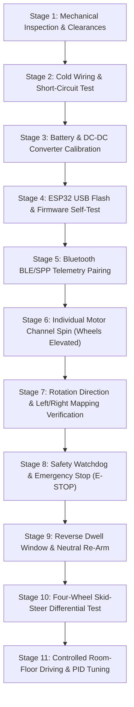

# Robo Racer 4WD — Staged Hardware Commissioning & Calibration Procedure

**Document:** `docs/hardware/testing-procedure.md`
**System:** Robo Racer 4WD Autonomous Robotic Vehicle
**Applicable Firmware:** `firmware/src/` (v1.1)
**Safety Protocol:** Strict sequential gatekeeping; never bypass a failed stage.
**Classification:** Software automated checks are verified; physical hardware stages are marked **PENDING PHYSICAL DELIVERY**.

---

## 1. Safety Rules & Commissioning Principles

> [!IMPORTANT]
> **MANDATORY BENCH SAFETY RULES:**
> 1. **Elevate the Vehicle:** During all initial bench testing (Stages 1 through 10), place the vehicle chassis on a stable wooden block or bench stand so that all four rubber wheels rotate freely in mid-air. Never test motors on the floor until Stage 11.
> 2. **Never Manipulate Live Wiring:** Always open the master toggle switch or disconnect the battery before adjusting screw terminals, moving jumper pins, or touching heatsinks.
> 3. **L298N Stopping Behavior:** Be technically precise. When `ENA`/`ENB` are `LOW` (or PWM duty cycle is 0) and `IN1`..`IN4` are `LOW`, the L298N output transistors enter a high-impedance state (**High-Z / Free-Running Coast**). This decouples electrical drive safely without thermal dissipation, but does **not** generate active dynamic or regenerative braking torque.
> 4. **Multimeter Before Motor Connection:** Never feed raw battery or uncalibrated converter output into the L298N or ESP32 without pre-verifying voltage with a digital multimeter.

---

## 2. The 11-Stage Commissioning Protocol

---

### Stage 1: Mechanical Inspection & Free Wheel Clearance
- **Preconditions:** Vehicle mechanically assembled as described in `assembly-guide.md`. No battery installed.
- **Procedure:**
  1. Rotate each of the four wheels by hand through multiple full rotations.
  2. Verify that the tire outer tread does not rub against the acrylic chassis frame, standoffs, or bolt ends.
  3. Verify minimum 8.5 mm lateral clearance between the inside tire wall and the chassis edge.
  4. Inspect the 4 optical speed encoder discs on the inner motor shafts for wobble or scraping against the lower deck slots.
- **Pass Criteria:** All 4 wheels spin smoothly against gearbox gear train with zero mechanical interference.
- **Status:** **PENDING PHYSICAL DELIVERY**

---

### Stage 2: Cold Wiring & Short-Circuit Continuity Test
- **Preconditions:** Battery disconnected. Master power switch open.
- **Procedure:**
  1. Set digital multimeter to Continuity Beeper mode ($\Omega$ / Beep).
  2. Place red probe on the switched battery positive rail and black probe on the Common Ground Bus.
  3. Measure resistance. A momentary beep while filter capacitors charge is normal, followed by high resistance ($> 10\,\text{k}\Omega$). A continuous low-impedance beep indicates a dead short.
  4. Probe between each motor output terminal (`OUT1`, `OUT2`, `OUT3`, `OUT4` on both drivers) and the ground bus.
- **Pass Criteria:** Zero dead shorts between positive rails and ground. Infinite or megaohm resistance on all logic and motor pins to ground.
- **Status:** **PENDING PHYSICAL DELIVERY**

---

### Stage 3: Battery & DC-DC Converter Multimeter Calibration
- **Preconditions:** Converter `OUT+` disconnected from L298N drivers and ESP32. Multimeter set to DC Volts ($20\,\text{V}$ range).
- **Procedure:**
  1. Measure raw battery pack voltage directly at battery terminals. Record as $V_{\text{pack}}$ (e.g. $11.85\,\text{V}$).
  2. Close master toggle switch to power the DC-DC converter input.
  3. Measure DC voltage across converter `OUT+` and `OUT-` terminals.
  4. Using a small flathead screwdriver, slowly adjust the blue 3296W cermet potentiometer until output reads **exactly $6.00\,\text{V} \pm 0.05\,\text{V}$**.
  5. Verify voltage stability over 60 seconds with no load.
  6. Measure attenuated voltage divider output at the $R1 / R2$ junction. Verify reading is between $1.0\,\text{V}$ and $2.1\,\text{V}$ (well below ESP32 3.3V damage threshold).
  7. Power down and safely connect converter `OUT+` to the L298N driver $12\text{V}$ supply terminals and ESP32 VIN pin.
- **Pass Criteria:** DC-DC converter output securely calibrated to $6.00\,\text{V}$ DC; divider tap safe for GPIO 34.
- **Status:** **PENDING PHYSICAL DELIVERY**

---

### Stage 4: ESP32 USB Power-Up & Firmware Flashing
- **Preconditions:** Battery power switch OFF. PC running PlatformIO / Arduino IDE connected to ESP32 micro-USB port.
- **Procedure:**
  1. Flash firmware from `firmware/src/` onto ESP32 via USB.
  2. Open Serial Monitor at 115200 baud.
  3. Observe boot output: verify bootloader loads, free heap is logged ($> 150\,\text{kB}$), Bluetooth SPP initializes as `ROBO-RACER-ESP32`, and all 12 motor pins configure to `OUTPUT` and `LOW`.
  4. Verify blue onboard status LED (GPIO 2) blinks at 1 Hz awaiting connection.
- **Pass Criteria:** Clean firmware boot without brownout detector trip; GPIO states verified LOW on startup.
- **Status:** **SOFTWARE BUILD VERIFIED (PASS) / HARDWARE FLASH PENDING**

---

### Stage 5: Bluetooth SPP / App Telemetry Pairing
- **Preconditions:** Robo Racer Android application installed on testing phone or running emulator. ESP32 powered.
- **Procedure:**
  1. Open Android application and tap Connect.
  2. Select `ROBO-RACER-ESP32` from paired devices.
  3. Verify Bluetooth SPP socket connects within 1500 ms.
  4. Check HUD telemetry: verify 20 Hz heartbeat telemetry packets received, CRC-8 integrity checks pass with zero packet drops, and status indicator switches to CONNECTED.
- **Pass Criteria:** Stable bidirectional communication; telemetry packet interval steady at $50\,\text{ms} \pm 5\,\text{ms}$.
- **Status:** **EMULATOR MOCK TRANSPORT VERIFIED (PASS) / PHYSICAL SPP PENDING**

---

### Stage 6: Individual Motor Channel Spin (Wheels Elevated)
- **Preconditions:** Wheels elevated off ground. Battery switch closed.
- **Procedure:**
  1. Send individual channel drive test commands at low duty cycle (PWM = 60, ~23%):
     - Channel 1: Front-Left Motor (`OUT1/OUT2` on `DRV-01`).
     - Channel 2: Rear-Left Motor (`OUT3/OUT4` on `DRV-01`).
     - Channel 3: Front-Right Motor (`OUT1/OUT2` on `DRV-02`).
     - Channel 4: Rear-Right Motor (`OUT3/OUT4` on `DRV-02`).
  2. Confirm each motor begins spinning once duty cycle exceeds `MIN_START_DUTY` (45).
- **Pass Criteria:** All 4 motors spin independently without whining or stalling.
- **Status:** **PENDING PHYSICAL DELIVERY**

---

### Stage 7: Rotation Direction & Left/Right Mapping Verification
- **Preconditions:** Wheels elevated.
- **Procedure:**
  1. Apply forward throttle command (+50%).
  2. Inspect wheel rotation:
     - Front-Left and Rear-Left wheels must spin counter-clockwise (looking from the left side) to roll vehicle forward.
     - Front-Right and Rear-Right wheels must spin clockwise (looking from the right side) to roll vehicle forward.
  3. If any motor rotates in reverse, power off and invert its individual motor leads at the corresponding L298N screw terminal block.
  4. Apply reverse throttle command (-50%). Verify all 4 wheels reverse rotation direction.
- **Pass Criteria:** Forward command produces forward wheel roll across all four corners.
- **Status:** **PENDING PHYSICAL DELIVERY**

---

### Stage 8: Safety Watchdog & Emergency Stop (E-STOP) Verification
- **Preconditions:** Motors running at +60% throttle in air.
- **Procedure:**
  1. Disconnect Bluetooth connection abruptly (or disable phone Bluetooth).
  2. Measure time until motors halt: Firmware watchdog timer (`WATCHDOG_TIMEOUT_MS = 500`) must cut PWM duty to 0 within $500\,\text{ms}$.
  3. Reconnect and apply +80% throttle.
  4. Tap the red on-screen **E-STOP** button in the Android controller.
  5. Confirm immediate cut-off ($< 50\,\text{ms}$) to High-Z coast state.
- **Pass Criteria:** Zero runaway condition; watchdog halts motors in $\le 500\,\text{ms}$; E-STOP halts immediately.
- **Status:** **SOFTWARE UNIT TEST VERIFIED (PASS) / PHYSICAL VERIFICATION PENDING**

---

### Stage 9: Reverse Dwell Window & Neutral Re-Arm
- **Preconditions:** Elevate wheels.
- **Procedure:**
  1. Command full forward throttle (+100%), then slam the pedal to full reverse (-100%).
  2. Observe oscilloscope or multimeter at motor terminals:
     - Firmware `REVERSE_DWELL_MS = 500` must enforce a $500\,\text{ms}$ zero-voltage electrical deadband before applying reverse polarity.
     - This prevents catastrophic back-EMF voltage spikes from blowing L298N flyback diodes and stripping TT plastic gears.
  3. Trigger an E-STOP event. Attempt to throttle up while still holding the throttle pedal.
  4. Confirm vehicle requires returning throttle to NEUTRAL ($0\%$) to re-arm the drive train.
- **Pass Criteria:** Reverse dwell window observed; neutral re-arm interlock prevents unintended acceleration.
- **Status:** **SOFTWARE UNIT TEST VERIFIED (PASS) / PHYSICAL OSCILLOSCOPE PENDING**

---

### Stage 10: Complete Four-Wheel Skid-Steer Differential Test
- **Preconditions:** Wheels elevated.
- **Procedure:**
  1. Command hard left steer (+100% steering, 0% throttle):
     - Left wheels rotate in reverse; right wheels rotate forward (in-place zero-radius pivot turn).
  2. Command hard right steer (-100% steering, 0% throttle):
     - Left wheels rotate forward; right wheels rotate in reverse.
  3. Command combined forward + 50% left steer:
     - Left wheels rotate slower forward; right wheels rotate faster forward (smooth progressive turn radius).
- **Pass Criteria:** Differential drive mixer correctly blends throttle and steering across all 4 wheels.
- **Status:** **MIXER ALGORITHM TESTED (PASS) / PHYSICAL VEHICLE PENDING**

---

### Stage 11: Controlled Room-Floor Driving & Tuning
- **Preconditions:** Stages 1–10 PASSED. Clear 3m × 3m open floor space.
- **Procedure:**
  1. Set speed limiter profile in Android settings to **TRAINING MODE (35% Max Power)**.
  2. Place vehicle on flat floor.
  3. Gradually apply forward throttle. Verify straight tracking with minimal drift.
  4. Test progressive braking and pivot steering.
  5. Check battery voltage drop under acceleration via Android HUD telemetry.
- **Pass Criteria:** Vehicle accelerates, steers, and stops crisply without tipping or skidding out of control.
- **Status:** **PENDING PHYSICAL DELIVERY**
