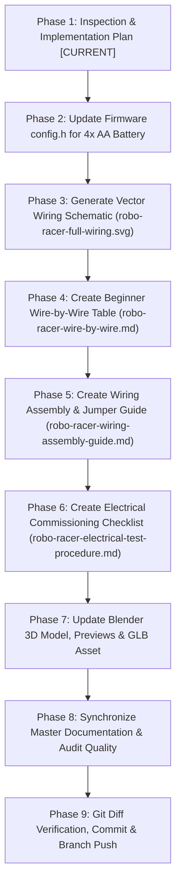

# Robo Racer 4WD — Physical Wiring Engineering & Implementation Plan

**Document Path:** `docs/hardware/wiring-implementation-plan.md`
**Date:** 2026-10-18
**Author:** Antigravity Autonomous Multidisciplinary Engineering Team
**Working Branch:** `fix/robo-racer-integration-safety`
**Status:** In Execution (Mandatory Phase 1 Baseline Established)

---

## 1. Executive Summary & Hardware Scope

This engineering implementation plan governs the development of the **complete, physically usable wiring plan for the Robo Racer 4WD robotic vehicle**.

Unlike decorative wiring artwork, this plan provides a technically rigorous, beginner-accessible, and electrically safe wiring architecture grounded in the verified physical inventory:
- **1 × ESP32 DevKit V1 (30-pin, CP2102, ESP-WROOM-32)**
- **2 × L298N Dual H-Bridge Motor Driver Modules (Red PCB, heatsink, Multiwatt15 IC)**
- **4 × Yellow TT Geared DC Motors (1:48 reduction) with 4 independent drive channels**
- **1 × 4-Cell AA Battery Holder Tray (Direct unswitched supply for ordinary alkaline/NiMH cells)**
- **1 × Blue Adjustable DC-DC Converter Module (Dual shielded 33 µH inductors, 3296W trimpot)**
- **NO master power switch installed** (Safe physical disconnect procedure established)
- **NO pre-installed inline fuse** (Recommended fuse rating and location documented as an upgrade)
- **1 × Precision Resistor Divider (100 kΩ / 20 kΩ) for analog battery telemetry to GPIO 34**

---

## 2. Unresolved Information & Component Evidence Classification

Every electrical and mechanical attribute is categorized using the authoritative four-tier evidence framework:
- **VERIFIED:** Supported by product listing photos, confirmed manufacturer datasheets, or firmware implementation.
- **MEASURED:** Measured directly from physical hardware with calipers, multimeter, or bench scale.
- **ESTIMATED:** Deduced from high-resolution photographs, standard hobby robotics conventions, or circuit topology analysis.
- **UNCONFIRMED:** Requires physical delivery, component unboxing, multimeter verification, or bench characterization.

| Component / Subsystem | Parameter | State / Value | Classification | Engineering Justification & Verification Gate |
|---|---|---|:---:|---|
| **Battery Source** | Cell Chemistry | 4× AA Alkaline (Eveready / Duracell) | **ESTIMATED** | Supplied photo shows 4-slot cylindrical holder. 4× 1.5V = 6.0V nominal (6.4V fresh, 4.4V cutoff). Legacy 3S Li-ion assumptions purged. |
| **Battery Holder** | Series Continuity | 4 cells in series (~6V) | **UNCONFIRMED** | Must verify with multimeter continuity before battery insertion to ensure no parallel/split taps exist. |
| **Power Switch** | Installed Switch | **NONE INSTALLED** | **VERIFIED** | User explicitly confirmed no master switch is available. Must establish safe manual disconnect (pull one cell or unplug battery terminal). |
| **DC-DC Converter** | Magnetic Circuit | 2× Shielded Inductors ("330" = 33 µH) | **VERIFIED** | Clearly visible in product listing photo (`media_1792340893405_c057a99d.png`). |
| **DC-DC Converter** | Component Model | amiciSolar XL6019 Module | **VERIFIED** | Confirmed from Flipkart product listing photograph (`media_1792340893363_d467156d.png`). |
| **DC-DC Converter** | Electrical Compatibility | Incompatible with 4× AA Alkaline pack | **BLOCKED — REGULATOR NOT SUITABLE OR NOT VERIFIED** | XLSEMI XL6019 datasheet mandates $V_{IN} \ge 5.0\text{V}$, UVLO $\approx 4.0\text{V}-4.5\text{V}$. 4× AA alkaline pack sags to $3.8\text{V}-4.5\text{V}$ under motor inrush. Boost topology cannot step down $6.4\text{V}$ fresh cells. Connections remain PROVISIONAL. If bench test fails, replace with wide-range buck-boost ($V_{IN} \ge 2.5\text{V}$) or isolated 5V power bank. |
| **L298N Modules** | Board Count & Channels | Exactly 2 modules, 4 discrete channels | **VERIFIED** | Driver 1: FL & RL; Driver 2: FR & RR. ENA/ENB jumpers removed for ESP32 LEDC PWM. Firmware drives each side in tandem. |
| **L298N Logic Power** | `5V-EN` Jumper State | **MUST BE REMOVED** on both boards | **VERIFIED** | When external 5.0V is supplied from DC-DC converter into L298N +5V screw terminals, the onboard 78M05 regulator must be disconnected. |
| **Battery Telemetry** | Divider Voltage Range | $V_{\text{pin}} = V_{\text{batt}} \times \frac{20\,\text{k}\Omega}{100\,\text{k}\Omega + 20\,\text{k}\Omega}$ | **VERIFIED** | At 6.4V max, $V_{\text{pin}} = 1.067\,\text{V}$ (well within ESP32 0–3.3V ADC range). Firmware thresholds updated from 3S to 4× AA. |

---

## 3. Power Architecture & Voltage Sag Analysis

### 3.1 4× AA Alkaline Battery Pack Behavior Under Load
- **Target Chemistry:** Ordinary AA Alkaline cells (Duracell / Eveready).
- **Open-Circuit Voltage:** Fresh alkaline AA cells exhibit ~1.55V–1.60V per cell ($6.2\text{V} - 6.4\text{V}$ pack voltage). Nominal is $6.0\text{V}$, cutoff threshold is $4.4\text{V}$.
- **Distinction from NiMH:** NiMH cells have fundamentally different nominal potentials ($1.2\text{V}/\text{cell}$, $4.8\text{V}$ nominal pack).
- **Internal Resistance (ESR):** Standard alkaline AA cells exhibit internal resistance $R_i \approx 0.15\,\Omega - 0.30\,\Omega$ per cell ($0.6\,\Omega - 1.2\,\Omega$ total pack ESR fresh, increasing with discharge).
- **TT Motor Load Characteristics:**
  - 4× TT motors drawing no-load running current: $4 \times 150\,\text{mA} - 250\,\text{mA} = 0.6\,\text{A} - 1.0\,\text{A}$ ($V_{\text{sag}} \approx 0.8\,\text{A} \times 0.8\,\Omega \approx 0.64\,\text{V} \rightarrow 5.5\,\text{V}$).
  - Inrush starting / skid-steer pivot current: $4 \times 0.6\,\text{A} - 0.8\,\text{A} = 2.4\,\text{A} - 3.2\,\text{A}$ ($V_{\text{sag}} \approx 2.5\,\text{A} \times 0.8\,\Omega \approx 2.0\,\text{V} \rightarrow 4.2\,\text{V}$).
  - Theoretical stall burst current: $3.2\,\text{A} - 4.8\,\text{A}$ ($V_{\text{sag}}$ drops pack terminal voltage down to $\sim 3.0\,\text{V} - 3.8\,\text{V}$).
- **L298N Bipolar Darlington Drop:** Internal transistors drop $V_{CE(sat)} \approx 1.8\,\text{V} - 2.5\,\text{V}$, leaving only $\sim 2.0\,\text{V} - 2.5\,\text{V}$ across the TT motor terminals under load and dissipating up to $3\,\text{W}$ per driver heatsink.

### 3.2 DC-DC Converter (amiciSolar XL6019) Electrical Safety Gate
- **Topology & Limits:** The ordered module is identified as the amiciSolar XL6019. Datasheet specifies operating input range $V_{IN} = 5.0\,\text{V} - 40\,\text{V}$ with UVLO $\approx 4.0\,\text{V} - 4.5\,\text{V}$.
- **Brownout & Reset Risk:** During motor startup or skid steering, battery voltage sags to $3.8\,\text{V} - 4.5\,\text{V}$, dropping below regulator minimum input, causing logic power dropout and ESP32 reboot.
- **Pass-Through Overvoltage Risk:** Boost topology cannot buck $6.2\,\text{V} - 6.4\,\text{V}$ fresh cells down to $5.0\,\text{V}$, passing raw battery voltage to ESP32 `VIN`.
- **Status Classification:** **BLOCKED — REGULATOR NOT SUITABLE OR NOT VERIFIED**. Power design is provisionally retained for documentation, but all affected connections are marked provisional.
- **Physical Commissioning Gate:**
  1. Measure no-load output across an input sweep ($3.5\text{V} - 6.5\text{V}$) on bench DC power supply.
  2. Perform dynamic step-load bench testing. **Never claim 5.00 V ± 0.05 V stability under load without physical measurement data.**
  3. If bench testing confirms dropout under 4-motor load or overvoltage pass-through at 6.4V, replace with wide-input buck-boost ($V_{IN} \ge 2.5\text{V}$) or separate 5V USB logic power bank.

---

## 4. Pin-to-Pin Connection Contracts

### 4.1 Drivetrain Control (ESP32 to Dual L298N)
- **L298N #1 (Left Drivetrain):**
  - `GPIO 18` -> ENA (FL Speed, LEDC PWM Ch 0, 20 kHz)
  - `GPIO 19` -> IN1 (FL Forward)
  - `GPIO 17` -> IN2 (FL Backward)
  - `GPIO 16` -> IN3 (RL Forward)
  - `GPIO 4`  -> IN4 (RL Backward)
  - `GPIO 25` -> ENB (RL Speed, LEDC PWM Ch 1, 20 kHz)
- **L298N #2 (Right Drivetrain):**
  - `GPIO 23` -> ENA (FR Speed, LEDC PWM Ch 2, 20 kHz)
  - `GPIO 22` -> IN1 (FR Forward)
  - `GPIO 21` -> IN2 (FR Backward)
  - `GPIO 27` -> IN3 (RR Forward)
  - `GPIO 14` -> IN4 (RR Backward)
  - `GPIO 26` -> ENB (RR Speed, LEDC PWM Ch 3, 20 kHz)
- **Jumper Configuration:**
  - `ENA` / `ENB` jumpers: **REMOVED** on both boards.
  - `5V-EN` regulator jumper: **REMOVED** on both boards.

### 4.2 Power & Ground Rails
- **Raw Battery Rail (Direct Unswitched):**
  - Battery Holder (+) -> L298N #1 Terminal `+12V`
  - Battery Holder (+) -> L298N #2 Terminal `+12V`
  - Battery Holder (+) -> DC-DC Converter `IN+`
  - Battery Holder (+) -> Voltage Divider $R_1$ (100 kΩ) High Side
- **Regulated 5.0V Logic Rail:**
  - DC-DC Converter `OUT+` (calibrated to 5.00V) -> ESP32 Pin `VIN` (5V)
  - DC-DC Converter `OUT+` (calibrated to 5.00V) -> L298N #1 Terminal `+5V`
  - DC-DC Converter `OUT+` (calibrated to 5.00V) -> L298N #2 Terminal `+5V`
- **Common Star Ground Bus (0V Return):**
  - Battery Holder (-)
  - DC-DC Converter `IN-` and `OUT-`
  - L298N #1 Terminal `GND`
  - L298N #2 Terminal `GND`
  - ESP32 Pin `GND`
  - Voltage Divider $R_2$ (20 kΩ) Low Side

---

## 5. Execution Phases & Deliverables

---

## 6. Acceptance Criteria

| Item | Requirement | Verification Method |
|---|---|---|
| **AC-01** | No installed switch present in schematics, tables, guides, or 3D models | Visual inspection of SVG, Markdown files, and Blender render outputs |
| **AC-02** | Direct unswitched battery connections clearly documented with safe manual disconnect steps | Review of assembly guide, wire-by-wire table, and testing procedure |
| **AC-03** | L298N jumpers (`ENA`, `ENB`, `5V-EN`) explicitly identified with removal instructions | Review of jumper guide, schematic labels, and wire table notes |
| **AC-04** | Battery telemetry formulas and firmware thresholds reflect 4× AA chemistry | Verification of `firmware/src/config.h` and calculation review ($1.07\text{V} \le 3.3\text{V}$) |
| **AC-05** | Full vector schematic (`docs/hardware/robo-racer-full-wiring.svg`) renders with distinct accessible line styles | SVG validation and rendering check |
| **AC-06** | Every wire in schematic matches wire-by-wire table 1:1 | Cross-reference audit of Wire IDs (`PWR-01..`, `SIG-L01..`, `SIG-R01..`, `MOT-01..`) |
| **AC-07** | Blender 3D model updated to reflect direct battery routing, no switch, and 6 dedicated wiring preview renders | Blender 5.2.0 headless execution, GLB export, and image verification |
| **AC-08** | Unit tests pass and debug APK compiles cleanly | Execution of `./gradlew.bat testDebugUnitTest` and `./gradlew.bat assembleDebug` |
| **AC-09** | Firmware regression suite passes | Execution of `test_protocol.exe` (7/7 tests passed) |
| **AC-10** | Clean git commit and push to `fix/robo-racer-integration-safety` | Git diff check, commit SHA logging, and push status confirmation |

---

## 7. Risks & Mitigations

1. **Risk:** User accidentally leaves batteries inserted when the vehicle is idle, causing slow drain or unintended motion if wires short.
   **Mitigation:** Prominently document "How to Turn Off Without a Switch" across the assembly guide, wire-by-wire table, and test procedure. Instruct user to remove at least one AA cell or unplug the battery connector when not in active test.
2. **Risk:** Uncalibrated DC-DC converter set to > 5.5V from factory, destroying ESP32 or L298N logic.
   **Mitigation:** Require Stage 3 Multimeter Calibration before connecting converter `OUT+` to any board.
3. **Risk:** Leaving the L298N `5V-EN` jumper on while connecting 5.0V from the converter, causing contention with the onboard 78M05 regulator.
   **Mitigation:** Boldly highlight `5V-EN` jumper removal in schematic, assembly guide, and wire table.
4. **Risk:** 4× AA alkaline batteries sagging below 3.5V during 4-motor stall, causing ESP32 reset.
   **Mitigation:** Document testing of current limits in software (firmware limits reverse to 63% and mixer has speed limit profiles), and provide failure-isolation guidance for heavy battery sag.
