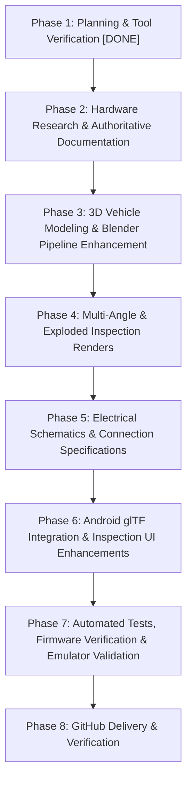

# Robo Racer 4WD — Autonomous Engineering Implementation Plan

**Branch:** `fix/robo-racer-integration-safety`
**Date:** 2026-10-18
**Author:** Antigravity Autonomous Engineering Agent
**Status:** In Execution (Mandatory Phase II Plan Recorded)

---

## 1. Executive Summary & Objective

This implementation plan governs the development of a comprehensive, dimension-aware **engineering digital twin** of the physical 4WD Robo Racer robotic vehicle.

Rather than treating 3D graphics as mere decorative art, the digital twin is an authoritative engineering model reflecting:
- The actual ordered 4WD double-deck acrylic robotic chassis kit.
- Four yellow TT geared DC motors and 66 mm rubber tires.
- Exactly two red L298N dual H-bridge motor driver modules (independent control of left and right pairs).
- The blue adjustable DC-DC converter (two-inductor automatic buck-boost architecture).
- The 30-pin ESP32 DevKit v1 (CP2102, ESP-WROOM-32) development board.
- The 4-cell battery holder and power distribution network.
- Rigorous pin-to-pin electrical mapping matching ESP32 firmware GPIO assignments.
- A 3D asset hierarchy (`robo_racer_car.glb`) with independent wheel pivots and chassis dynamics nodes loaded into the Robo Racer Android controller application.
- Comprehensive hardware documentation: Bill of Materials, Dimensions & Assumptions, Electrical Connection Map, Assembly Guide, Staged Commissioning Procedure, and editable SVG schematics.

---

## 2. Source-of-Truth Files & Asset Paths

| Purpose | Canonical Path | Description |
|---|---|---|
| Implementation Plan | `docs/model/implementation-plan.md` | Master plan, execution phases, and acceptance criteria |
| Reference Research | `docs/model/reference-research.md` | Evidence-backed research on physical components |
| Model Specification | `docs/model/model-specification.md` | Node hierarchy, coordinates, materials, and scale |
| Bill of Materials | `docs/hardware/bill-of-materials.md` | Authoritative BOM with status classification |
| Dimensions & Assumptions | `docs/hardware/dimensions-and-assumptions.md` | Mechanical measurements, tolerances, clearances |
| Electrical Connection Map | `docs/hardware/electrical-connection-map.md` | Pin-to-pin connection specifications |
| Wiring Schematic | `docs/hardware/wiring-schematic.svg` | Vector schematic diagram of all interconnects |
| Power Distribution | `docs/hardware/power-distribution.svg` | Vector diagram of power rails, regulators, and returns |
| Assembly Guide | `docs/hardware/assembly-guide.md` | Step-by-step physical build and wiring guide |
| Testing Procedure | `docs/hardware/testing-procedure.md` | 11-stage hardware commissioning and safety checks |
| Model Generator Script | `tools/modeling/generate_robo_racer_model.py` | Reproducible Blender 5.2.0 Python model generator |
| Master Blender File | `tools/modeling/robo_racer_car.blend` | Master authoring scene source |
| Rendered Previews | `docs/model/previews/` | Multi-angle inspection renders (including exploded and side) |
| Production 3D Asset | `app/src/main/assets/models/robo_racer_car.glb` | Binary glTF 2.0 asset bundled inside Android APK |
| Android Model Parser & Engine | `app/src/main/java/com/example/roboracer/renderer/gltf/` | glTF parser, node hierarchy, and animation logic |
| Android Viewport & Renderer | `app/src/main/java/com/example/roboracer/renderer/CarGLSurfaceRenderer.kt` | OpenGL ES 2.0 surface renderer and lifecycle |
| Firmware Pin Definitions | `firmware/src/config.h` | Hardware GPIOs, PWM parameters, and safety bounds |

---

## 3. Hardware Inventory & Evidence Classification

Every component and parameter is categorized using the authoritative four-tier evidence framework:
- **VERIFIED:** Confirmed by primary product documentation or exact kit inventory.
- **MEASURED:** Physically measured from delivered hardware.
- **ESTIMATED:** Inferred from clear photographic evidence or standard dimensional conventions.
- **UNCONFIRMED:** Pending physical delivery, bench metering, or destructive verification.

| Item | Component | Key Identified Attributes | Classification | Unresolved / Pending Verification |
|---|---|---|---|---|
| 1 | 4WD Robotic Chassis Kit | Dual acrylic plates (~255×150 mm), contoured bumpers, wheel cutouts, brass standoffs, speed encoders | **ESTIMATED** / **VERIFIED** | Brown kraft paper vs transparent plate finish; exact mounting hole spacing |
| 2 | TT DC Gear Motors (4×) | Yellow plastic gearbox (1:48), dual flat output shafts, 3–6V DC brushed canister | **VERIFIED** | Exact coil resistance and stall current under load |
| 3 | 66 mm Wheels (4×) | Black natural rubber tires with chevron treads, 5-spoke yellow ABS rims | **VERIFIED** | Friction coefficient on diverse surfaces |
| 4 | L298N Driver Boards (2×) | Red PCB, Multiwatt15 package, black finned heatsink, 78M05 regulator, screw terminals, logic headers | **VERIFIED** | Exact thermal rise without forced cooling |
| 5 | Adjustable DC-DC Converter | Blue PCB, 2× shielded power inductors ("330" / 33 µH), blue 3296W trimpot, 2× electrolytic caps | **ESTIMATED** / **UNCONFIRMED** | Exact IC (XL6009/XL6019/FP5139 auto buck-boost topology); maximum continuous current |
| 6 | ESP32 Dev Board | 30-pin DevKit v1, CP2102 USB bridge, ESP-WROOM-32 module, Micro-USB, tactile EN/BOOT buttons | **VERIFIED** | ADC linearity calibration on GPIO 34 |
| 7 | Battery Holder | 4-cell inline cylindrical holder with red/black silicone pigtails | **ESTIMATED** | Cell chemistry (Alkaline 6.0V vs NiMH 4.8V vs 14500 Li-ion 14.8V vs 3S 18650 pack) |
| 8 | Voltage Divider | R1 = 100 kΩ, R2 = 20 kΩ (6:1 ratio) to GPIO 34 | **ESTIMATED** | Resistor tolerance calibration via multimeter |

---

## 4. Mechanical Coordinate System & Dimension Assumptions

### 4.1 Coordinate Systems
- **Blender Modeling Space (Z-Up):**
  - Origin $(0, 0, 0)$: Ground plane directly under chassis geometrical center.
  - $+X$: Vehicle Right ($+76\,\text{mm}$ to wheel center).
  - $-X$: Vehicle Left ($-76\,\text{mm}$ to wheel center).
  - $+Y$: Forward / Front ($+65\,\text{mm}$ to front axle).
  - $-Y$: Backward / Rear ($-65\,\text{mm}$ to rear axle).
  - $+Z$: Upward ($33\,\text{mm}$ axle height, $24\,\text{mm}$ lower deck bottom, $57\,\text{mm}$ upper deck bottom).
- **glTF 2.0 Export Space (Y-Up, `export_yup=True`):**
  - $+Y$: World Up.
  - $-Z$: World Forward (Heading).
  - $+Z$: World Rear (Toward Chase Camera).
  - $+X$: Vehicle Right.
  - $-X$: Vehicle Left.

### 4.2 Mechanical Clearances & Placement
- Lower deck houses 4× TT motors mounted via acrylic brackets underneath the lower deck.
- Battery holder is mounted in the lower deck central bay to maintain a low center of gravity.
- Upper deck houses the dual L298N drivers (symmetrically left and right), the adjustable DC-DC converter (rear-center), and the ESP32 board (front-center with antenna protruding forward for RF isolation).
- Total vehicle dimensions: Length ~260 mm (wheel-to-wheel outer envelope), Width ~178 mm (outer tire face to outer tire face), Height ~82 mm (ground to top of heatsinks).

---

## 5. Electrical Architecture & Pin-to-Pin Contract

### 5.1 Motor Driver Mapping
- **Driver 1 (Left Side — Front-Left & Rear-Left Motors):**
  - `ENA` (LEDC Channel 0, GPIO 18) — PWM speed control for Front-Left channel.
  - `IN1` (GPIO 19) — Front-Left Forward.
  - `IN2` (GPIO 17) — Front-Left Backward.
  - `IN3` (GPIO 16) — Rear-Left Forward.
  - `IN4` (GPIO 4) — Rear-Left Backward.
  - `ENB` (LEDC Channel 1, GPIO 25) — PWM speed control for Rear-Left channel.
- **Driver 2 (Right Side — Front-Right & Rear-Right Motors):**
  - `ENA` (LEDC Channel 2, GPIO 23) — PWM speed control for Front-Right channel.
  - `IN1` (GPIO 22) — Front-Right Forward.
  - `IN2` (GPIO 21) — Front-Right Backward.
  - `IN3` (GPIO 27) — Rear-Right Forward.
  - `IN4` (GPIO 14) — Rear-Right Backward.
  - `ENB` (LEDC Channel 3, GPIO 26) — PWM speed control for Rear-Right channel.

### 5.2 Power Rails & Safety
- **High-Current Rail:** Battery ($4.8\,\text{V} - 12.6\,\text{V}$) passes through main power switch to DC-DC converter input.
- **Regulated Motor Rail ($6.0\,\text{V}$):** DC-DC converter steps voltage to 6.0V, distributed to L298N 12V terminal blocks.
- **Logic Rail ($5.0\,\text{V} / 3.3\,\text{V}$):** ESP32 powered via 5V VIN or micro-USB during bench testing. 78M05 onboard L298N jumper enabled when motor rail is $\ge 7\text{V}$, or removed if backfeeding. Common ground connects all modules.
- **ADC Divider:** Battery positive connected via 100kΩ/20kΩ divider to GPIO 34 (ADC1_CH6).

---

## 6. Model Node Hierarchy & Animation Contract

```
car_root [World Space Root]
├── chassis_root [Chassis Pitch & Roll Dynamics]
│   ├── chassis_bottom_deck [Lower laser-cut plate]
│   ├── chassis_top_deck [Upper laser-cut plate]
│   ├── chassis_standoffs [6x M3 brass standoffs & screws]
│   ├── motor_left_front [TT motor, gearbox, canister, bracket]
│   ├── motor_left_rear [TT motor, gearbox, canister, bracket]
│   ├── motor_right_front [TT motor, gearbox, canister, bracket]
│   ├── motor_right_rear [TT motor, gearbox, canister, bracket]
│   ├── esp32_board [30-pin devkit, shield, CP2102, buttons, LEDs]
│   ├── l298n_left [Left dual H-bridge module, heatsink, terminals]
│   ├── l298n_right [Right dual H-bridge module, heatsink, terminals]
│   ├── power_converter [Dual-inductor buck-boost module, trimpot, caps]
│   ├── battery_pack [Battery holder with cells and silicone leads]
│   ├── wiring_harness [Machine-mapped color-coded routing]
│   └── rear_brake_lights [Emissive red brake lamps]
├── front_left_wheel_pivot [Axle Origin: (-0.076, 0.065, 0.033)]
├── front_right_wheel_pivot [Axle Origin: (+0.076, 0.065, 0.033)]
├── rear_left_wheel_pivot [Axle Origin: (-0.076, -0.065, 0.033)]
└── rear_right_wheel_pivot [Axle Origin: (+0.076, -0.065, 0.033)]
```

---

## 7. Android Asset-Loading & Renderer Architecture

1. **Asset Deployment:** Asset located at `app/src/main/assets/models/robo_racer_car.glb`.
2. **glTF Parser:** Native binary glTF parser in `com.example.roboracer.renderer.gltf.GltfParser` extracts buffers, accessors, meshes, nodes, and materials without external heavy library dependencies.
3. **Renderer:** `CarGLSurfaceRenderer` executes on Android OpenGL ES 2.0 thread:
   - Dynamic 4-wheel rotational physics driven by real resolved speed and throttle.
   - Chassis pitch (squat on acceleration, dive on braking) and roll (lean into skid-turns).
   - Rear brake light emission trigger when `isBraking == true`.
   - Studio lighting shader with specular reflection and directional key/fill lights.
   - Fallback procedural geometry retained safely in case of asset read errors.
4. **Interactive Component Inspection Mode:** UI mode allowing camera orbiting, component callout pills (ESP32, L298N Left, L298N Right, Buck-Boost, Battery), pin-out info cards, and exploded assembly view toggling without disrupting real-time drive controls.

---

## 8. Ordered Implementation Phases



---

## 9. Measurable Acceptance Criteria

| Phase | Deliverable | Acceptance Criteria |
|---|---|---|
| Phase 2 | BOM & Reference Docs | `docs/hardware/bill-of-materials.md` and `dimensions-and-assumptions.md` created with 4-tier evidence classifications. |
| Phase 3 | Blender Script & GLB | `generate_robo_racer_model.py` generates model matching 4 uploaded photos (dual inductors on converter, 4-slot battery holder, acrylic decks with cutouts); GLB passes node validation. |
| Phase 4 | Inspection Renders | 7 required preview images rendered to `docs/model/previews/` (rear, front, top, closeup, side, app camera, exploded). |
| Phase 5 | Schematics & Assembly | `electrical-connection-map.md`, `wiring-schematic.svg`, `power-distribution.svg`, `assembly-guide.md`, and `testing-procedure.md` created. |
| Phase 6 | Android Integration | Android app compiles; glTF loads cleanly; animated wheels respond to throttle/steering; interactive inspection mode implemented. |
| Phase 7 | Testing & Emulator | `./gradlew.bat testDebugUnitTest` passes; APK builds and installs on `Pixel_10_Pro` emulator; real screen captures verified. |
| Phase 8 | Git Delivery | All files committed to `fix/robo-racer-integration-safety`; pushed to GitHub; SHA verified. |

---

## 10. Risk Analysis & Mitigations

1. **Risk:** Unconfirmed DC-DC converter IC topology might burn out motors or ESP32 if incorrect voltage is supplied.
   **Mitigation:** Document strict pre-power multimeter calibration procedure. Require converter output voltage to be set to 6.0V with no load connected before wiring to L298N or ESP32.
2. **Risk:** High-poly 3D models causing frame drops on Android OpenGL ES thread.
   **Mitigation:** Keep triangle count under 30,000 vertices; share materials; cache draw calls; use lightweight unlit/diffuse shader with baked vertex normals.
3. **Risk:** Driving hitboxes blocked by 3D inspection overlays.
   **Mitigation:** Explicit mode toggle in settings/header bar; drive controls remain untouched in standard mode.
